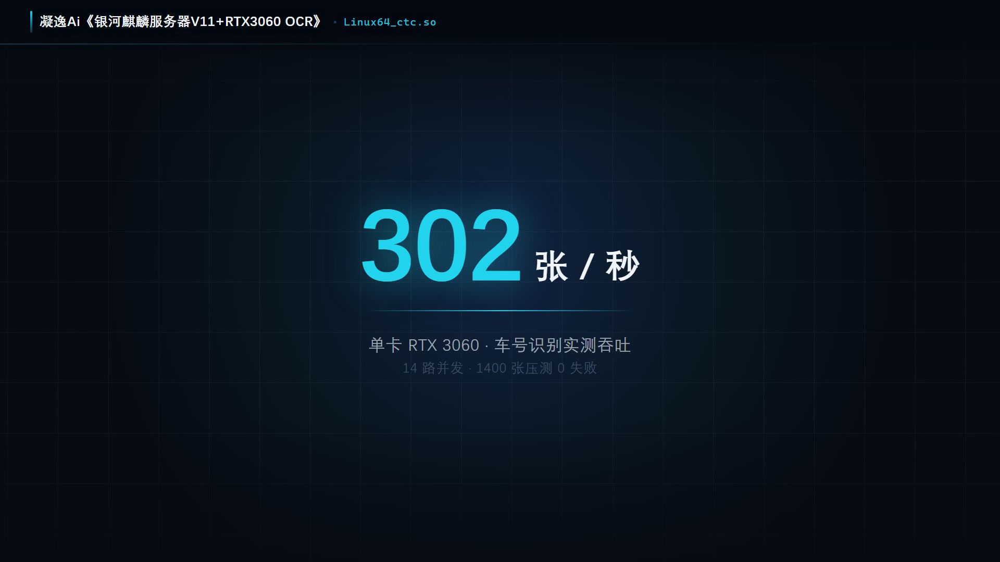
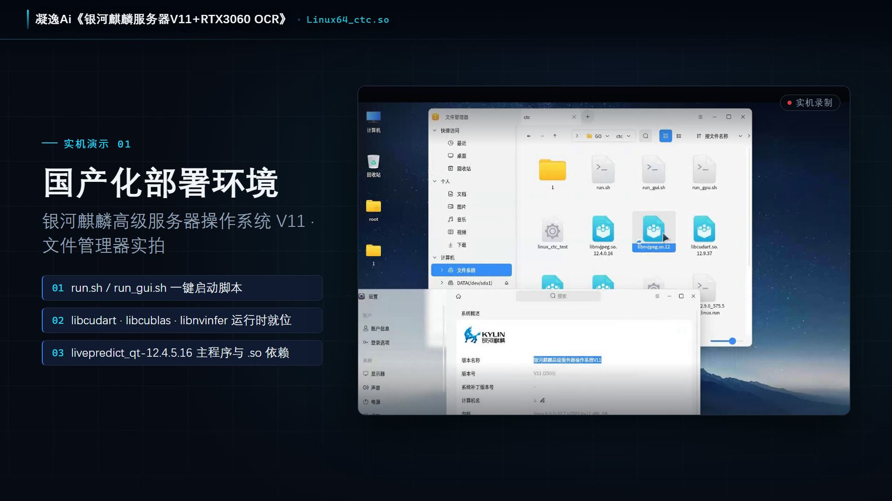
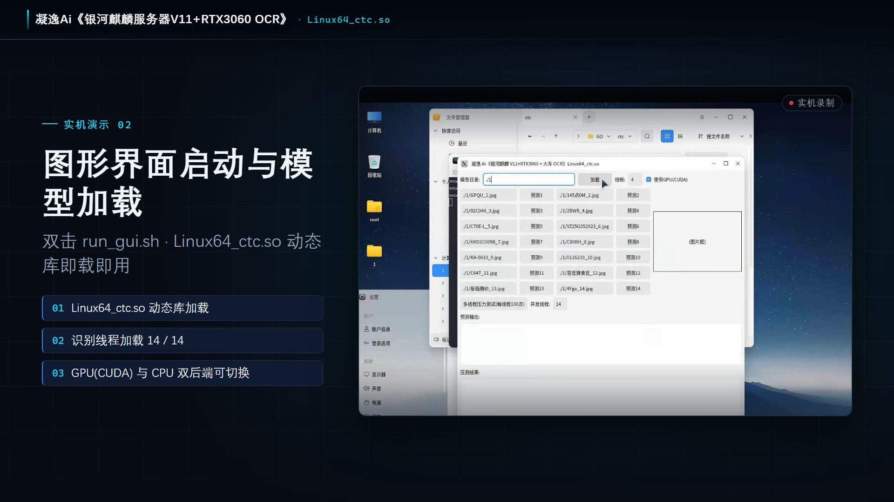
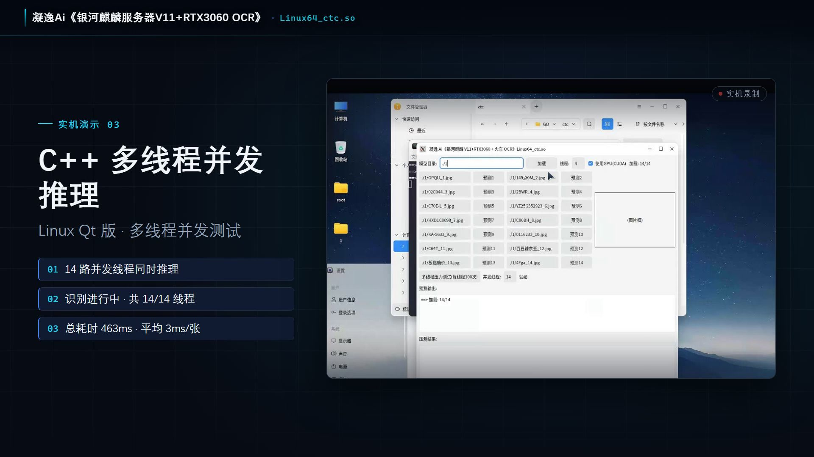
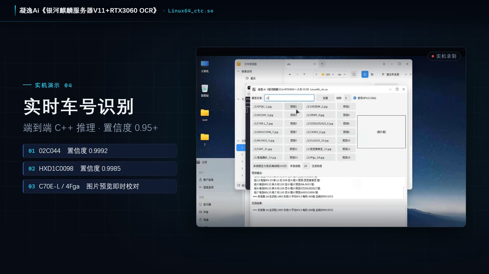
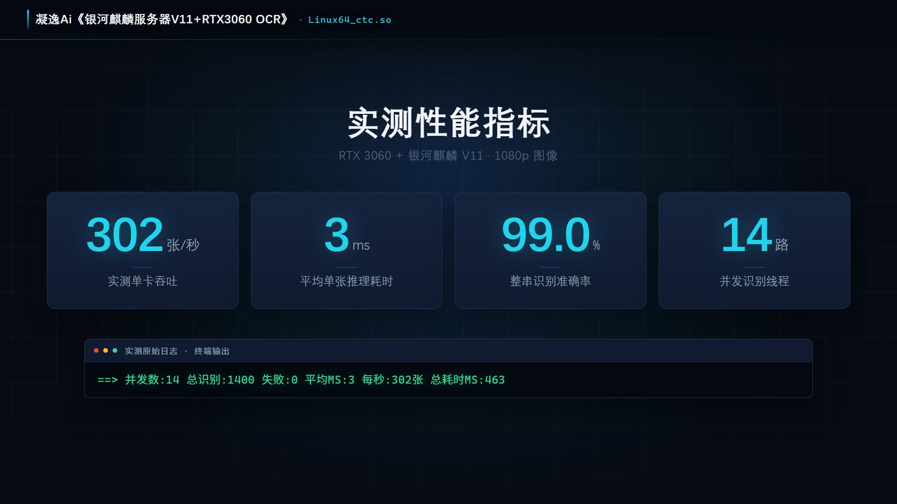
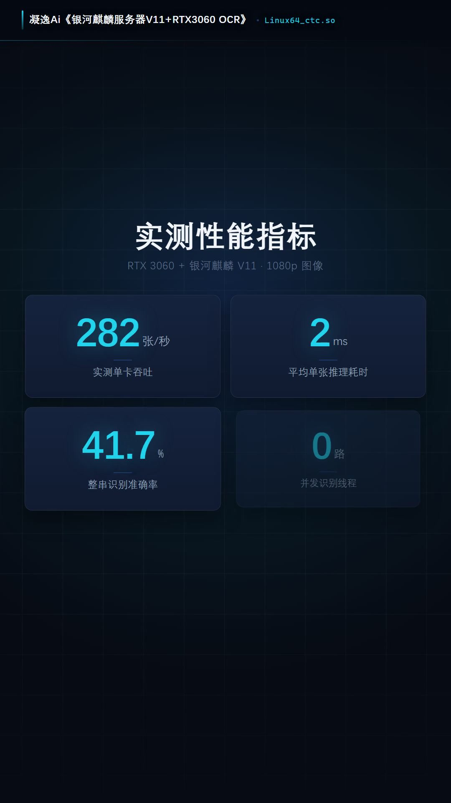

# Kylin Advanced Server OS V11 + RTX 3060
## Розпізнавання тексту на GPU мовою C++ · Перевірено на реальному обладнанні

**NingYi AI — «Kylin V11 + RTX 3060 OCR» · Linux64_ctc.so**

[中文](README.md) · [English](README.en.md) · [English · US/EU](README.en-US.md) · [日本語](README.ja.md) · [한국어](README.ko.md) · [Deutsch](README.de.md) · [العربية](README.ar.md) · [עברית](README.he.md) · [Українська](README.uk.md) · [繁體中文](README.zh-TW.md)

---

## Виміряні показники

| Показник | Виміряне значення |
|---|---|
| Пропускна здатність (одна GPU, RTX 3060) | **302 зображення / с** |
| Середня затримка інференсу | **3 мс / зображення** |
| Точність розпізнавання повного рядка | **99.0 %** |
| Потоків інференсу одночасно | **14** |
| Обсяг навантажувального тесту | 1 400 зображень · **0 збоїв** · 463 мс загалом |
| Діапазон впевненості | 0.9489 – 0.9998 |
| Перше зображення | 277 мс (включно з ініціалізацією рушія та відеопам'яті), у стабільному режимі 2 – 10 мс |

> Сирий лог термінала (без змін):
> `==> 并发数:14 总识别:1400 失败:0 平均MS:3 每秒:302张 总耗时MS:463`

---

## Скриншоти з реальної системи

> Середовище: Kylin Advanced Server OS V11 на x86 (Hygon), NVIDIA RTX 3060. Усі кадри знято на реальному обладнанні — без макетів.

### 01 · Середовище локального розгортання

Знято у файловому менеджері Kylin V11: скрипти запуску `run.sh` / `run_gui.sh` в одну дію, бібліотеки середовища виконання `libcudart` / `libcublas` / `libnvinfer` на місці, а також програма `livepredict_qt` з усіма залежностями `.so`.

### 02 · Запуск графічного інтерфейсу та завантаження моделі

Подвійний клік на `run_gui.sh` запускає графічний інтерфейс Qt під Linux, а `Linux64_ctc.so` завантажується одразу. Потоки розпізнавання ініціалізуються 14 / 14, доступне перемикання між GPU (CUDA) та CPU.

### 03 · Паралельний інференс на C++ (багатопотоковий)

14 потоків виконують інференс одночасно, прогрес оновлюється в реальному часі: 463 мс загалом, 3 мс на зображення.

### 04 · Розпізнавання номерів вагонів у реальному часі

Наскрізний інференс на C++: номери вагонів і номери контейнерів зчитуються за один прохід, з миттєвим зіставленням із вихідним зображенням.

### 05 · Підсумок виміряних показників

---

## Сфери застосування

`Сортувальні станції` · `Ворота портів` · `Козлові крани` · `Контейнерні майданчики` · `OCR у промисловому баченні`

- **Розпізнавання номерів вагонів** — номери вагонів типів C / P / N / G / B / L / K / X
- **Зчитування номерів контейнерів** — автоматичний збір на воротах портів і під час роботи козлових кранів
- **Загальний промисловий OCR** — шильди, маркування, серійні номери

---

## Повністю власне розгортання · готово до ізольованої мережі

- Повна адаптація обладнання, операційної системи та AI-середовища
- Сумісність із вітчизняними платформами x86 (Hygon та інші)
- **Жодні дані не залишають внутрішню мережу** — без зовнішніх API-викликів і без залежності від хмари

---

## Про цей репозиторій

> Цей репозиторій **призначений виключно для демонстрації виміряних результатів і скриншотів**.
> Він **не містить вихідного коду, ваг моделей чи алгоритмічних бібліотек**.
>
> Пакунок розгортання постачається як офлайн-інсталятор `.run`, що містить бібліотеку
> `Linux64_ctc.so` та скрипти запуску `run.sh` / `run_gui.sh`.

### Портретна обкладинка (9:16)

**NingYi AI · 凝逸Ai**

